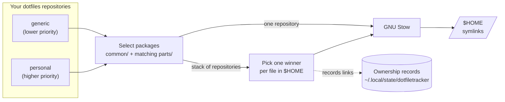
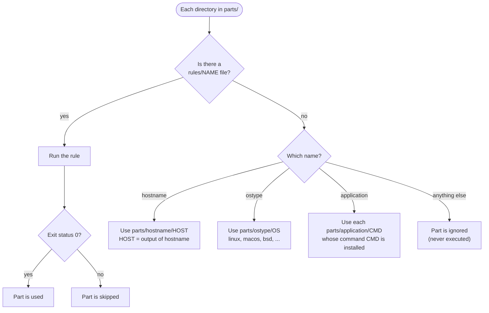
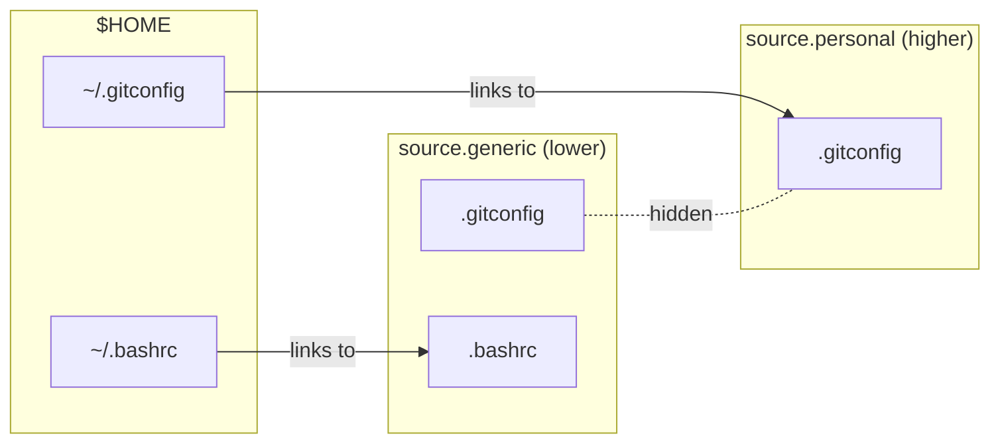
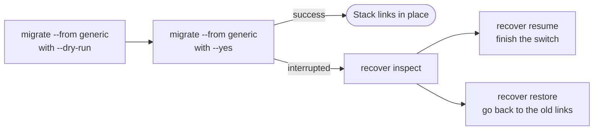

# envmaker

envmaker links your dotfiles into `$HOME` with GNU Stow. You keep your
configuration files in a Git repository; envmaker picks the packages that fit
the current machine and links them into place. You can use one repository, or
stack a shared "generic" repository under a "personal" one so that your own
files override the shared ones.

An example dotfiles repository in envmaker's layout is
[sasuw/dotfiles](https://github.com/sasuw/dotfiles).

## How it works



1. **Select.** In each repository, everything under `common/` is used. Packages
   under `parts/` are used only when they match this machine: its host name,
   its operating system, an installed command, or a rule script you write.
2. **Resolve.** With several repositories, envmaker decides which repository
   provides each file. The highest-priority repository wins the whole file.
3. **Link.** GNU Stow creates the symlinks in `$HOME`. In stack mode envmaker
   records which links it owns, so it can later remove or move exactly those.

## Install

envmaker is a set of Bash and Perl scripts; there is nothing to build.

```bash
git clone https://github.com/sasuw/envmaker.git "$HOME/envmaker"
```

You also need:

- Bash, Git and standard Unix tools such as `find`, `awk`, `sed`, `xargs`,
  `readlink` and `mktemp`.
- Perl 5.16 or newer with its core modules, including `JSON::PP` and
  `Unicode::Normalize`. Some distributions package core modules separately.
- GNU Stow 2.4.1 installed at `/opt/stow-2.4.1/bin/stow`, with its Perl modules.

envmaker does not install any of these. [Prerequisites](docs/prerequisites.md)
shows how to build and install Stow under `/opt`, which needs administrator
rights. envmaker is tested on Linux; macOS and FreeBSD have not been verified.

The examples below call `envmaker.sh` through a shell variable:

```bash
envmaker="$HOME/envmaker/envmaker.sh"
```

## Use one dotfiles repository

Create a new dotfiles repository, or use an existing one you trust:

```bash
bash "$envmaker" init "$HOME/dotfiles"
```

`init` creates an empty Git repository with this layout. It refuses a
directory that already has content, and it creates no links.

```text
dotfiles/
├── common/                      # always used
│   └── git/                     # a Stow package
│       └── .gitconfig           #   -> ~/.gitconfig
├── parts/                       # used only when they match this machine
│   ├── hostname/laptop/         # only on the host named "laptop"
│   ├── ostype/macos/            # only on macOS
│   ├── application/tmux/        # only if the tmux command is installed
│   └── work/                    # only if rules/work exits with 0
└── rules/
    └── work                     # executable rule script for parts/work
```

Each directory directly below `common/` is a Stow package. Its contents mirror
paths relative to `$HOME`, so `common/git/.gitconfig` becomes `~/.gitconfig`.
A selected part works the same way: each directory directly below it, such as
`parts/hostname/laptop/ssh/`, is a package.

This is how envmaker decides which parts to use:



A rule file that is not executable skips its part. Parts named
`hostname`, `ostype` and `application` never execute a part name: only
the `hostname` command runs, and installed commands are only looked up.
The generated `docs/getting_started.md` in your new repository explains the
layout again.

Preview, then apply:

```bash
bash "$envmaker" --dotfiles-dir "$HOME/dotfiles" listdirs
bash "$envmaker" --dotfiles-dir "$HOME/dotfiles" --yes --dry-run execstow stow
bash "$envmaker" --dotfiles-dir "$HOME/dotfiles" --yes execstow stow
```

After you add or remove files, run `execstow restow` the same way.

envmaker always runs Stow with `--no-folding`: directories in `$HOME` stay real
directories, and each file gets its own link. This lets several packages put
files into the same directory, such as `~/.config`.

To avoid typing `--dotfiles-dir` each time, create
`${XDG_CONFIG_HOME:-$HOME/.config}/dotfiletracker/config` with:

```text
dotfiles_dir="~/dotfiles"
```

`--dotfiles-dir` still overrides this file for a single run. It is refused
when a stack (see below) already manages your home directory.

If a regular file is in the way of a link, envmaker moves it aside before
linking: first to `FILE.orig`, then `FILE.orig.1`, `FILE.orig.2` and so on.
Check those backups before you delete them. A symlink in the way is not moved;
Stow then reports a conflict.

To remove the links again, preview with `--yes --dry-run execstow delete`, then
run `--yes execstow delete`. It unlinks only the packages that are selected
right now. Links from a part that is no longer selected, for example because
its rule now fails or its command was uninstalled, stay in place. So keep the
repository and its original selection (rules, host name, installed commands)
until `execstow delete` has removed all its links.

`ls` lists links into the repository up to two levels below `$HOME`, and
`--yes del` removes links into the repository up to four levels below `$HOME`,
whether or not their part is still selected. Deeper links, such as
`~/.local/share/app/data/file`, are not touched by either.

The commands `plan`, `explain` and `migrate` work only in stack mode.

## Stack a generic and a personal repository

Put the repositories in the same config file instead of `dotfiles_dir`, lowest
priority first:

```text
source.generic="~/dotfiles/generic"
source.personal="~/dotfiles/personal"
```

Use either `source.*` entries or `dotfiles_dir`, not both.



The higher repository wins each file as a whole, by its path in `$HOME`. It
does not matter which package the file is in, or whether both copies are
identical. Delete the personal copy and the next apply links the generic one
again. Each repository keeps its own rules and hooks.

For a home directory that has no envmaker links yet:

```bash
bash "$envmaker" plan                          # which repository wins each file (JSON)
bash "$envmaker" --dry-run execstow restow     # preview
bash "$envmaker" execstow restow               # apply
bash "$envmaker" explain .gitconfig            # who provides this file, who is hidden (JSON)
bash "$envmaker" ls                            # recorded links and their owners (JSON)
bash "$envmaker" listdirs                      # selected directories as ID:PATH
```

A repeated `--source ID=PATH` option replaces the configured list for one run.

Stack mode is stricter than single-repository mode. It refuses to touch files
it does not manage, links that point elsewhere, and managed links that someone
replaced. It does not make `.orig` backups. To remove its links, preview with
`--yes --dry-run execstow delete`, then run `--yes execstow delete` or
`--yes del`. Removal uses envmaker's records, so it also works when a
repository is no longer available.

### Switch from existing Stow links

If your home directory already has links from an earlier single-repository
setup or from plain Stow, migrate them explicitly. `--from` names the
repository that owns the old links.



```bash
bash "$envmaker" --dry-run migrate --from generic
bash "$envmaker" --yes migrate --from generic
```

The switch is not atomic. If it stops halfway, run `recover inspect` and then
either `recover resume` or `recover restore`. The
[migration and recovery guide](docs/migrate_overlay.md) covers every step and
refusal.

## Things to know before you use it

- **Rules and hooks are programs.** Rule scripts and the `hostname` command run
  during selection, also in a preview. `--dry-run` stops envmaker from changing
  files; it does not sandbox those programs. Only register repositories you
  trust.
- **Post-stow hooks.** Executable files in `hooks/post-stow.d/` of a repository
  run in name order after a successful `stow` or `restow`, and in stack mode
  also after a `migrate` or an apply that changed nothing. Each gets the Stow
  action (`stow` or `restow`) as its argument and `DOTFILES_DIR` in its
  environment, plus `DOTFILETRACKER_SOURCE_ID` in stack mode. Hooks never run
  in a preview, on deletion or during recovery. A failing hook prints a warning
  and does not undo the links.
- **Editing through a link edits the source.** Opening `~/.gitconfig` edits the
  file in the repository that provides it. Some editors save by replacing the
  link with a regular file. In single-repository mode, the next `stow` or
  `restow` moves that file aside as a `.orig` backup and restores the link, so
  copy your changes into the repository before you delete the backup. In stack
  mode, envmaker reports a conflict and leaves the file alone until you move it
  yourself.
- **Helper scripts.** `util/add-zsh-completion.sh` saves a Zsh completion into
  `parts/application/COMMAND/completions/`. `util/convert_aliases_to_functions.sh`
  and `util/remove_function_keyword.sh` rewrite shell files in a repository.
  In stack mode they need `--source ID`; the two rewrite helpers also accept
  explicit source file paths. This includes completion imports with
  `--no-stow`.
- **Where data lives.** The configuration file is
  `${XDG_CONFIG_HOME:-$HOME/.config}/dotfiletracker/config`. Ownership records
  and the operation journal are in
  `${XDG_STATE_HOME:-$HOME/.local/state}/dotfiletracker`. Old records are kept;
  envmaker never deletes them automatically.
- **Two files in your home directory.** Every operation that changes links
  creates `~/.dotfiletracker-lock` and `~/.dotfiletracker-owner.json`. They
  prevent two envmaker runs from changing your home directory at once. Do not
  delete them.
- **Environment variables.** `ASSUME_YES=1` works like `--yes`.
  `STOW_VERSION=VERSION` selects `/opt/stow-VERSION/bin/stow`; see
  [prerequisites](docs/prerequisites.md).

Reference documentation:

- [Source registry](docs/source_registry.md): config format and source rules.
- [Overlay planner](docs/overlay_planner.md): how winners and conflicts are decided.
- [Overlay state and recovery](docs/overlay_state.md): records, journal and locks.
- [Migration and recovery](docs/migrate_overlay.md): switching from existing links.
- [Prerequisites](docs/prerequisites.md) and [testing](docs/testing.md).

## Development

Run the checks before you send a change:

```bash
python3 -I scripts/scan_public.py --root .
bash scripts/check_public.sh
```

The first scans for secrets with a pinned gitleaks version. The second checks
the syntax of all shell and Perl files, runs ShellCheck on itself, and runs a
smoke test and the regression suites in a temporary home directory. Both fail on tool errors. The checks need more
tools than envmaker itself, such as Zsh and POSIX AWK; see the
[scan policy](docs/public_scan.md) for the full list. CI installs them
explicitly. Before each release, the maintainers also run a private check for
names and terms that must not be published.

## License

envmaker is released under the [MIT license](LICENSE). GNU Stow and the other
prerequisites keep their own licenses.
